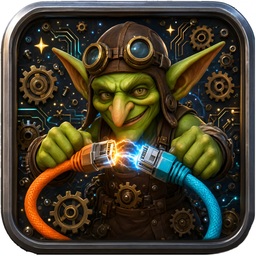

<div align="center">
  
  <h1>地精虫洞发生器</h1>
  <p><b>Goblin Wormhole Generator</b></p>
  <p>受够了直联的高延迟，专门为《Azeroth Survivors》打造的低延迟联机启动器，把 300ms+ 压到 30ms 级</p>
  <p>点击下载 [Releases](../../releases)  `地精虫洞发生器.exe`</p>
</div>

---

## 这是什么

《Azeroth Survivors（艾泽拉斯幸存者）》是一款基于魔兽世界 1.12 素材的同人 Roguelike。
它的官方 Co-op 大厅走境外中继，中国大陆玩家延迟常在 **300ms 以上**，还伴随丢包。

游戏本身预留了「房主本地监听 + 客户端直连」的联机模式（环境变量 `WOW_ROGUE_COOP_HOST` / `WOW_ROGUE_COOP_JOIN`），
但没有图形界面，手动配置容易出错。**地精虫洞发生器**把这条链路做成了一个 5 步向导：

- 配合 Radmin LAN 组建虚拟局域网
- 主机一键开房，自动检测并展示本机虚拟 IP
- 客户机填入 IP 即可直连，附带连通性测试
- 全程不经过官方中继

## 功能

| 功能 | 说明 |
|---|---|
| 5 步向导 | 选游戏 → 检查网络 → 选身份 → 填参数 → 启动 |
| 主机模式 | 自动检测 `26.x.x.x` 地址，一键复制给队友 |
| 客户机模式 | 输入主机 IP，TCP 连通性测试并显示延迟 |
| 安全启动 | 强制以游戏目录为工作目录，避免资源缺失闪退 |
| 配置记忆 | 自动保存上次的游戏路径与参数（`GWG.json`） |
| 无依赖运行 | 单文件 exe，不需要安装 Python |

## 工作原理

游戏客户端读取两个环境变量决定联机角色：

| 身份 | 环境变量 |
|---|---|
| 主机 | `WOW_ROGUE_COOP_HOST=<端口>`（默认 7777） |
| 客户机 | `WOW_ROGUE_COOP_JOIN=<主机IP>:<端口>` |

再配合 `WOW_ROGUE_COOP_PASSWORD` 设置房间密码、`WOW_ROGUE_UPDATE_AUTO=0` 关闭自动更新，
并以游戏所在目录为工作目录启动进程，即完成一次低延迟联机。

> 实测：本机回环 26–28ms（含 30Hz tick 量化）；同城/同省组网约 10–40ms。

## 快速开始

### 使用者

1. 下载 [Releases](../../releases) 中的 `地精虫洞发生器.exe`
2. 双方安装 [Radmin LAN](https://www.radmin-lan.cn/) 并加入**同一个**虚拟网络
3. 主机运行程序 → 选择 `AzerothSurvivors.exe` → 选「主机」→ 启动游戏 → 把显示的 IP 发给朋友
4. 朋友选「客户机」→ 填主机 IP → 启动游戏

> 主机开房后**不要关闭游戏窗口**；游戏启动后**本程序可以关闭**。

### 开发者

```bash
pip install pywebview pillow pyinstaller
python Goblin-Wormhole-Generator.py        # 直接运行
```

构建单文件 exe：

```bash
python -m PyInstaller --noconfirm --clean --onefile --windowed \
  --name 地精虫洞发生器 --icon icon.ico --add-data "icon_b64.txt;." \
  Goblin-Wormhole-Generator.py
```

## 兼容性

- Windows 10 / 11 x64
- 需要 WebView2 Runtime（Win10 21H2+ / Win11 自带）
- 双方游戏版本必须一致

## 已知限制

- 仅支持 TCP 直连，需要虚拟组网或公网可达
- 不修改游戏文件，不提供任何游戏资源
- 游戏更新可能改变环境变量行为

## 免责声明

本程序仅作为个人娱乐、技术交流及学习研究之用，不具备任何商业运营属性。严禁任何个人或组织将本程序用于任何形式的商业用途，包括但不限于：

- 擅自对本程序进行复制、修改、反编译或衍生开发后用于盈利；
- 将本程序或其部分内容用于商业广告、付费服务、捆绑销售等经营活动；
- 利用本程序获取非法利益或损害第三方合法权益。

本程序的所有知识产权归开发者所有。对于违反本公告规定的行为，保留追究相关责任人法律责任的权利。

本项目与 Blizzard Entertainment 无关，不包含任何《魔兽世界》游戏资源。
《Azeroth Survivors》由 Aethus 开发，本项目仅为第三方辅助工具。

## License

[非商业许可](LICENSE) —— 允许个人使用与分发，禁止任何商业用途。
